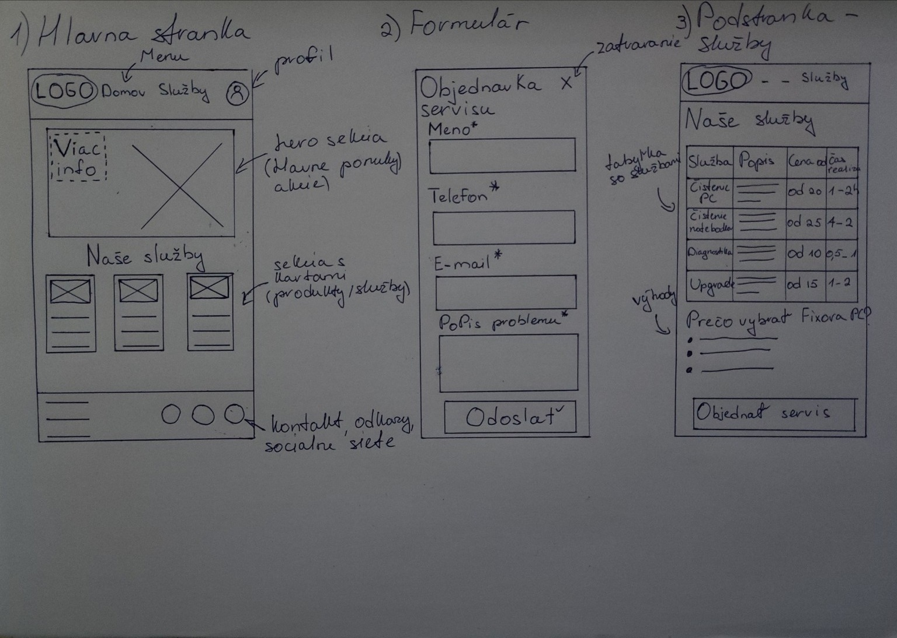
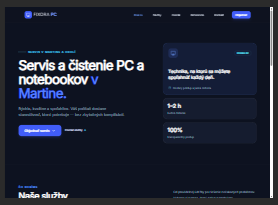
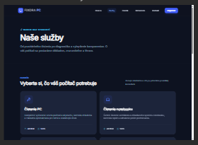
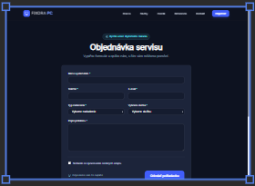

# Zadanie webu: FIXORA PC – servis a čistenie počítačov

> **Podklad pre vývoj v Bloku 11.** Tento dokument je prevedený z pôvodného návrhu webovej stránky. Obsahuje zadanie, persony, navigáciu, obrazovky, interakcie a vizuálny štýl. Obrázky z pôvodného Wordu sú pripojené samostatne. Osobné údaje autora a školská titulná strana sa do verejného repozitára neprenášajú.

## Úvod

V súčasnosti zákazníci pri výbere servisu počítačov očakávajú, že základné informácie nájdu rýchlo a prehľadne na internete. Dôležitá je najmä ponuka služieb, orientačné ceny, približný čas realizácie a jednoduchý spôsob kontaktovania firmy.

Cieľom tejto práce je navrhnúť webovú stránku FIXORA PC pre malú lokálnu firmu zameranú na servis, čistenie a údržbu počítačov a notebookov v Martine. Návrh webu vychádza z potrieb používateľov, vytvorených persón, informačnej architektúry a papierového prototypu. Následne je spracovaný do interaktívneho prototypu, ktorý umožňuje overiť rozloženie stránky, navigáciu a hlavné používateľské cesty ešte pred samotnou realizáciou webu.

Výsledkom je jednoduchý a prehľadný návrh webu, ktorý má zákazníkovi uľahčiť získanie potrebných informácií a odoslanie servisnej požiadavky bez zbytočného telefonovania.

## 1. Cieľ

FIXORA PC je jednoduchý web pre malú lokálnu firmu poskytujúcu servis, čistenie a údržbu počítačov a notebookov v Martine. Používateľ má rýchlo zistiť, aké služby firma ponúka, orientačnú cenu a približný čas servisu a následne môže odoslať servisnú požiadavku bez potreby telefonovania.

- Kto bude web používať? Ľudia z Martina a okolia, ktorí potrebujú čistenie, diagnostiku, údržbu alebo jednoduchý servis PC či notebooku.
- Aký problém web rieši? Používateľ nemusí telefonovať len kvôli základným informáciám. Na jednom mieste nájde služby, orientačné ceny, približný čas a formulár na odoslanie požiadavky.
- V čom je web lepší? Je jednoduchý a prehľadný. Najdôležitejšie informácie sú dostupné bez zložitého hľadania a objednávka má minimum krokov.
- Prečo web vzniká z pohľadu firmy? Firma chce získať nové zákazky, ušetriť čas pri opakovaných otázkach a pôsobiť profesionálnejšie.

**KPI:** aspoň 10 servisných požiadaviek mesačne cez web a minimálne 30 % všetkých požiadaviek cez formulár namiesto telefonátu.

## 2. Používatelia

Návrh vychádza z troch persón. Každá predstavuje inú situáciu používania a pomáha rozhodnúť, ktoré informácie a funkcie musia byť na webe.

| Persóna | Segment | Hlavný problém | Čo potrebuje | Čo od nej chce firma |
| --- | --- | --- | --- | --- |
| Lucia, 22 rokov | Študentka a hráčka – stolný herný PC | PC je hlučný a prehrieva sa; nevie, čo presne čistenie zahŕňa a koľko stojí. | Jasný cenník, obsah služby, približný čas servisu, jednoduchý formulár. | Získať objednávku cez web a ukázať bezpečný odborný servis. |
| Martin, 36 rokov | Pracujúci používateľ – notebook | Notebook je horúci, hlučný a spomaľuje; obáva sa dlhého servisu a neistej ceny. | Zrozumiteľné vysvetlenie, cena a čas servisu, rýchly kontakt. | Ukázať transparentný postup a krátky čas servisu. |
| Peter, 44 rokov | Malý podnikateľ – viac kancelárskych PC | Potrebuje riešiť viac zariadení naraz a minimalizovať výpadok. | Kontakt pre viac zariadení, orientačná cena, termín a možnosť uviesť počet zariadení. | Získať opakovaného firemného zákazníka a servis viacerých zariadení. |

Spoločný záver z persón: web musí najmä ukázať služby, orientačný cenník, približný čas servisu, postup objednávky a jednoduchý kontakt. Zložité účty, registrácia alebo veľký používateľský systém nie sú potrebné.

## 3. Štruktúra webu

Štruktúra nadväzuje na mind mapu z Coggle a zostáva zámerne malá. Hlavné vetvy sú:

- **Služby:** Čistenie PC a notebookov, diagnostika, upgrade komponentov, orientačný cenník.
- **Objednávka:** Ako to funguje, objednávkový formulár, približný čas realizácie.
- **Referencie:** Hodnotenia a neskôr fotografie realizácií.
- **Kontakt:** Telefón, e-mail, lokalita Martin a okolie, otváracie hodiny.

Aktuálny interaktívny prototyp používa hybridnú štruktúru. Na hlavnej stránke je stručný prehľad najdôležitejších častí – služieb, orientačného cenníka, postupu „Ako to funguje“, referencií a kontaktu. Po kliknutí na položku menu sa otvorí rozšírená samostatná obrazovka konkrétnej časti. Objednávkový formulár je samostatná obrazovka a po úspešnom odoslaní sa zobrazí potvrdenie.

## 4. Obrazovky

Interaktívny prototyp prenáša papierový návrh do digitálnej klikateľnej verzie. Aktuálna verzia používa princíp „prehľad na hlavnej stránke + detail po kliknutí“. Používateľ tak vidí základné informácie hneď, ale pri potrebe detailu otvorí samostatnú rozšírenú obrazovku. Texty sú skutočné, nie výplňové, a hlavné tlačidlá majú konkrétny cieľ.

| Obrazovka | Najdôležitejší obsah | Kam vedú hlavné akcie |
| --- | --- | --- |
| Domov | Stručný prehľad služieb, cenníka, postupu, referencií a kontaktu. | Na detail Služieb, Cenníka, Referencií, Kontaktu alebo na Objednávku. |
| Služby | Rozšírený popis čistenia PC, čistenia notebooku, diagnostiky a upgradu. | Na Cenník alebo Objednávku. |
| Cenník | Orientačné ceny a približný čas jednotlivých služieb. | Na Objednávku. |
| Referencie | Rozšírená spätná väzba a hodnotenia v kartách. | Na Objednávku. |
| Kontakt | Telefón, e-mail, lokalita, otváracie hodiny a krátky postup. | Na Objednávku alebo späť cez menu. |
| Objednávka | Formulár so zariadením, službou, problémom a súhlasom. | Po úspešnom odoslaní na potvrdenie; z potvrdenia späť na Domov. |

### Papierový prototyp

Pred vytvorením interaktívneho prototypu bol web najskôr navrhnutý na papieri. Papierový prototyp obsahuje tri základné obrazovky – hlavnú stránku, objednávkový formulár a podstránku Služby. Slúžil na overenie rozloženia hlavných prvkov, navigácie a základných používateľských ciest ešte pred vytvorením digitálnej verzie.

*Obrázok 1: Papierový prototyp webu FIXORA PC. Zdroj: vlastné spracovanie.*

### 4.1 Hlavná stránka

Najdôležitejšie: používateľ za pár sekúnd pochopí, že FIXORA PC je servis a čistenie PC a notebookov v Martine a okolí. Hlavná stránka obsahuje skrátené verzie všetkých dôležitých častí: služby, „Ako to funguje“, orientačný cenník, referencie, kontakt a výrazné CTA „Objednať servis“.

*Obrázok 2: Hlavná stránka webu FIXORA PC. Zdroj: vlastné spracovanie.*

Prepojenia: menu otvára samostatné detailné obrazovky Služby, Cenník, Referencie a Kontakt. Tlačidlo „Objednať servis“ otvorí formulár.

### 4.2 Rozšírená obrazovka – Služby

Najdôležitejšie: rozšírená stránka vysvetľuje štyri hlavné služby podrobnejšie než hlavná stránka – čistenie PC, čistenie notebooku, diagnostiku a upgrade komponentov. Používateľ sa z nej môže prepnúť na cenník alebo rovno na objednávku.

*Obrázok 3: Rozšírená obrazovka Služby. Zdroj: vlastné spracovanie.*

Prepojenia: tlačidlo „Pozrieť cenník“ otvorí rozšírený cenník a „Objednať servis“ otvorí objednávkový formulár.

### 4.3 Rozšírená obrazovka – Cenník

Najdôležitejšie: používateľ porovná orientačné ceny a približný čas servisu. Pri každej službe je krátky opis. Ak používateľ nevie, ktorú službu potrebuje, môže v objednávke zvoliť „Iné“ a opísať problém.

Poznámka: konkrétne sumy a časy v prototype sú modelové/orientačné údaje pre návrh rozhrania. Finálny web má používať iba potvrdený firemný cenník a reálne termíny.

Prepojenia: hlavné CTA „Objednať servis“ vedie na objednávkový formulár.

### 4.4 Rozšírená obrazovka – Referencie

Najdôležitejšie: samostatná stránka dáva referenciám viac priestoru než stručná ukážka na hlavnej stránke. Hodnotenia sú zobrazené ako prehľadné karty, aby používateľ vedel rýchlo posúdiť dôveryhodnosť služby.

Poznámka: mená a texty referencií použité v prototype sú modelové a slúžia iba na testovanie rozloženia. Vo finálnej verzii sa majú nahradiť skutočnými, overenými hodnoteniami zákazníkov.

Prepojenia: CTA na stránke Referencie vedie na objednávku servisu.

### 4.5 Rozšírená obrazovka – Kontakt

Najdôležitejšie: používateľ nájde na jednom mieste telefón, e-mail, lokalitu Martin a okolie a otváracie hodiny. Stránka zároveň ponúka priamy prechod na online objednávku a stručne pripomína trojkrokový postup servisu.

Poznámka: telefón, e-mail, lokalita a otváracie hodiny v ukážke sú modelové kontaktné údaje projektu, nie reálne firemné kontakty. Nie sú vytvorené ako telefonické ani e-mailové odkazy.

Prepojenia: tlačidlo „Prejsť na objednávku“ otvorí objednávkový formulár.

### 4.6 Objednávkový formulár

Najdôležitejšie: zákazník odošle servisnú požiadavku s minimom potrebných údajov. Formulár obsahuje meno a priezvisko, telefón, e-mail, typ zariadenia, vybranú službu, popis problému a súhlas so spracovaním údajov. Pri voľbe „Viac zariadení“ sa zobrazí pole „Počet zariadení“, čo zodpovedá persóne Peter.

*Obrázok 4: Objednávkový formulár. Zdroj: vlastné spracovanie.*

Prepojenia a správanie: formulár kontroluje povinné polia. Ak niečo chýba, zobrazí zoznam chýb. Po úspešnom odoslaní sa namiesto formulára zobrazí potvrdenie „Ďakujeme. Vašu požiadavku sme prijali a ozveme sa vám čo najskôr.“ Používateľ sa môže vrátiť na hlavnú stránku alebo vytvoriť novú požiadavku.

### 4.7 Interakcie v prototype

- Stránková interakcia – menu a CTA prepínajú medzi Domovom, Službami, Cenníkom, Referenciami, Kontaktom a Objednávkou.
- Štýlová interakcia – položky menu, tlačidlá a karty menia vzhľad pri prejdení myšou alebo pri fokusovaní.
- Formulárová interakcia – kontrola povinných polí a podmienené pole „Počet zariadení“ pri voľbe „Viac zariadení“.
- Mobilná interakcia – na menšej obrazovke sa klasické menu zmení na hamburger menu, ktoré sa otvorí a zatvorí kliknutím.

V prototype nie sú zámerne pridávané používateľské účty, registrácia, e-shop ani iné funkcie, ktoré nevychádzajú z persón a informačnej architektúry.

## 5. Vizuálny štýl

Finálna vizuálna verzia prototypu používa moderný technologický štýl vhodný pre PC servis. Základ tvorí tmavomodré/navy pozadie, tmavšie karty, biely a svetlosivý text a modré až cyan akcenty pre hlavné akcie. Rozhranie používa zaoblené karty, jasnú typografickú hierarchiu, decentné tiene a jednoduché line ikony.

- Pozadie: tmavé navy odtiene (napr. #0B1220 a #121C2F).
- Akcenty: modrá a cyan pre CTA, aktívne menu, ikony a zvýraznenie dôležitých prvkov.
- Komponenty: sticky header, hero sekcia, karty služieb, cenníkové karty, referencie, formulár a footer.
- Responzivita: desktopové vodorovné menu sa na mobile mení na hamburger menu; karty a formulár sa prispôsobujú šírke obrazovky.

Cieľom vizuálu nie je herný alebo e-shopový vzhľad, ale čistý, seriózny a dôveryhodný servisný web. Používateľ má vždy jasne vidieť, čo môže urobiť ďalej.

### 5.1 Poznámka k údajom a testovaniu

Interaktívny prototyp slúži na overenie návrhu. Modelové ceny, kontaktné údaje a referencie sa pred reálnym publikovaním nahradia potvrdenými údajmi firmy. Podľa zadania má prototyp prejsť aj druhým guerilla testom s iným kolegom; zistené problémy sa majú zapracovať do poslednej verzie prototypu.

Prototyp bol otestovaný s kolegom pomocou troch jednoduchých úloh – nájsť cenník, vybrať vhodnú službu a odoslať servisnú požiadavku. Používateľ sa v základnej navigácii orientoval bez väčších problémov. Počas testovania bolo upravené prepojenie medzi hlavnou stránkou, detailnými obrazovkami a objednávkovým formulárom, aby boli jednotlivé kroky jednoznačnejšie. Po úpravách boli všetky hlavné cesty v prototype opätovne skontrolované.

## Podmienky pred zverejnením (vyplývajúce z návrhu)

- Modelové ceny a časy nenahrádzať vymyslenými „skutočnými“ cenami ani termínmi.
- Modelové referencie nezobrazovať ako reálne recenzie zákazníkov.
- Do verejnej stránky nevkladať osobné kontaktné údaje autora; zverejniť len potvrdené firemné kontakty.
- Ak objednávkový formulár nemá funkčný prijímací systém, nesmie tvrdiť, že bola požiadavka reálne doručená firme.
- Pri realizácii zachovať hybridnú navigáciu: stručný prehľad na Domove a rozšírené samostatné obrazovky.

## Poznámka k style guide

Dokument opisuje **tmavomodrú/navy paletu s modro-cyan akcentmi**, zatiaľ čo prenesený `style-guide.md` z portfólia môže používať inú akcentnú farbu (napr. zelenú). Tento rozpor treba pri tvorbe webu vedome vyriešiť podľa pôvodného prototypu FIXORA PC; vizuálne pravidlá majú byť pre servisný projekt jednotné.
